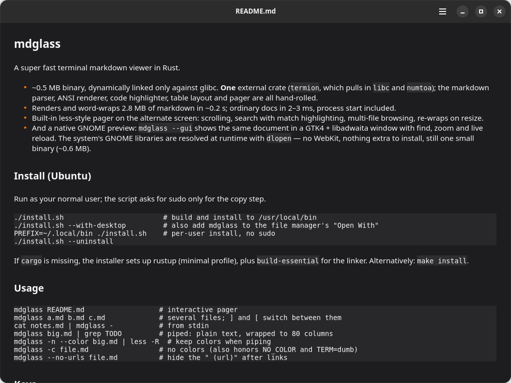

# mdglass

A fast, tiny Markdown viewer for Linux, for the terminal and the GNOME desktop.



- One small binary (~0.6 MB), no WebKit, no runtime to install
- Terminal pager with search, or a native GNOME window (`--gui`)
- Tables, task lists, quotes and highlighted code blocks
- Find, zoom, and live reload when the file changes

## Install

Download from the [latest release](https://github.com/hpn777/mdglass/releases/latest):

```bash
sudo apt install ./mdglass_0.1.0-3_amd64.deb            # Ubuntu 22.04+ / Debian
flatpak install --user ./mdglass-0.1.0-x86_64.flatpak   # any distro (GNOME window)
```

Or from source:

```bash
git clone https://github.com/hpn777/mdglass && cd mdglass
./install.sh --with-desktop     # adds "MD Glass" to the app grid and "Open With"
```

## Usage

```bash
mdglass README.md           # view in the terminal
mdglass --gui README.md     # open in a GNOME window
cat notes.md | mdglass      # read from stdin
```

In the terminal, press `/` to search, `n` for the next match, `]` `[` to switch files, and `q` to quit.
In the window, use `Ctrl+F` to find, `Ctrl+O` to open, and `Ctrl++` / `Ctrl+-` to zoom.
Prose wraps to the window; wide tables and diagrams keep their shape and scroll sideways.
Those wraps are real line breaks, as in the terminal: find does not match a phrase split
across two lines, copied text keeps the breaks, and resizing or zooming clears a selection.
In the window, ```` ```mermaid ```` blocks and untyped box-art blocks are drawn as vector
graphics (terminal output stays text); any block that cannot be drawn stays a code block.
`examples/diagrams.md` demos every kind, with `examples/screenshots/` as proof.

See `man mdglass` for all options.

## Development

`make check` runs the unit, terminal and GUI tests.

## License

MIT
