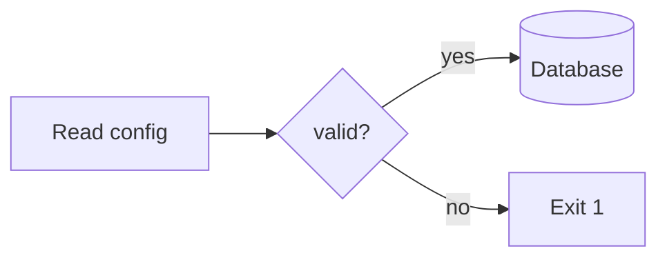
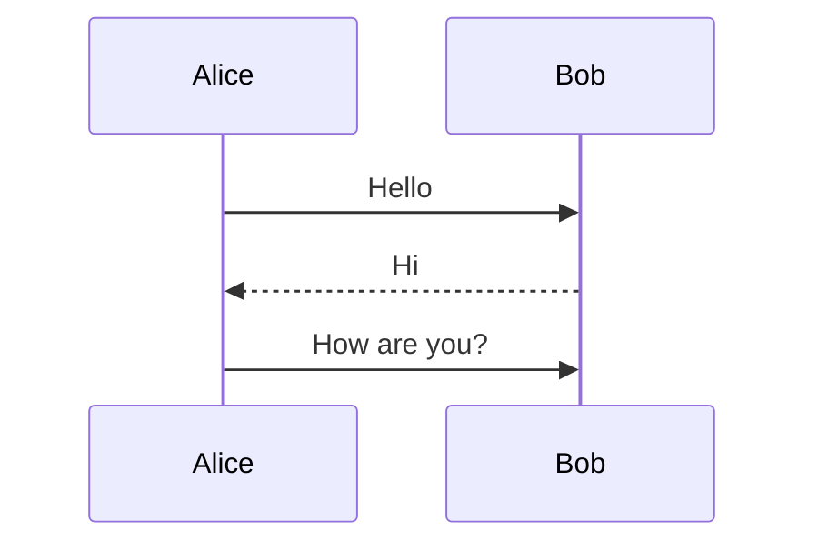
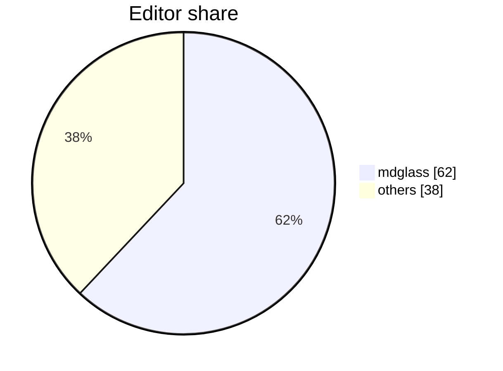

# Diagrams, drawn as vectors

The GNOME window (`mdglass --gui`) renders the blocks below as real vector
pictures in a palette that follows your light/dark setting; the terminal
renders this same file as plain code. Zooming (`Ctrl++`) re-renders them
sharp, and any block the recognizers reject stays searchable code text.

## Box art

An untyped fence that looks like box art is vectorized by the built-in
aasvg engine, arrows and all:

```
+--------+      +--------+
| Client |----->| Server |
+--------+      +--------+
      ^               |
      |      json     |
      +---------------+
```

## Unicode box drawing

The same engine after a one-line Unicode translation, so `╭─╮ │ ╰─╯` and
`<==` arrows from `boxdraw`-style tools vectorize too:

```text
╭───────╮   upload   ╭───────╮
│ Cache │<===========│  DB   │
╰───────╯            ╰───────╯
```

## Flowchart

Fenced as `mermaid`, drawn in-process by mermaid-rs-renderer:



## Sequence diagram



## Pie chart



## Stays as text

Data tables keep their content searchable and copyable on purpose, and so
do typed code blocks, HTML snippets and progress bars — a picture of data
would hide it from find:

```
+----+-------+
| id | name  |
+----+-------+
| 1  | alice |
| 2  | bob   |
+----+-------+
```

---

The three dark-theme captures of this file, from the shipped build:
`screenshots/diagrams-art.png` (box art, unicode art, flowchart),
`screenshots/diagrams-sequence.png` (sequence diagram),
`screenshots/diagrams-pie.png` (pie chart above the table, still text).
